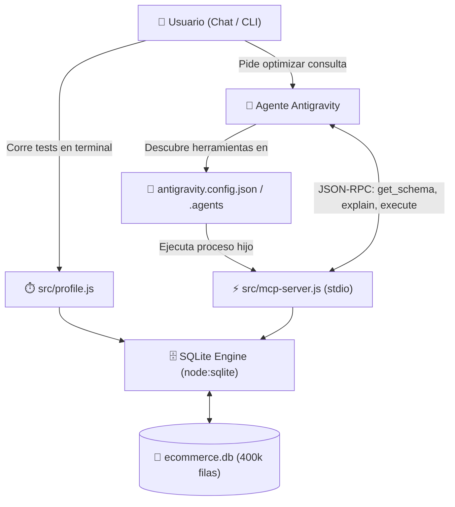

# 📖 Manual de Usuario: Laboratorio de Optimización SQL con Agentes y MCP

Bienvenido al manual oficial de **DB Optimizer Lab**. Este entorno fue diseñado desde cero para aprender, experimentar y evaluar técnicas de optimización de bases de datos relacionales utilizando **Agentes de Inteligencia Artificial** y el protocolo estándar **MCP (Model Context Protocol)**.

---

## 📑 Tabla de Contenidos

1. [¿De qué se compone este laboratorio?](#1-de-qué-se-compone-este-laboratorio)
2. [Arquitectura del Sistema y Flujo de Trabajo](#2-arquitectura-del-sistema-y-flujo-de-trabajo)
3. [Explicación Detallada de los Archivos del Proyecto](#3-explicación-detallada-de-los-archivos-del-proyecto)
   - [`src/seed.js` (Generación de Datos)](#srcseedjs)
   - [`src/profile.js` (Medición y Profiling)](#srcprofilejs)
   - [`src/mcp-server.js` (Servidor MCP para Agentes)](#srcmcp-serverjs)
   - [`queries_lentas.sql` (Banco de Consultas)](#queries_lentassql)
4. [Cómo Interpretar el Plan de Ejecución (`EXPLAIN QUERY PLAN`)](#4-cómo-interpretar-el-plan-de-ejecución)
5. [Tutorial Práctico: Tu Primer Ciclo de Optimización](#5-tutorial-práctico-tu-primer-ciclo-de-optimización)
6. [Cómo interactúa el Agente de Antigravity vía MCP](#6-cómo-interactúa-el-agente-de-antigravity-vía-mcp)
7. [Referencia de Comandos](#7-referencia-de-comandos)

---

## 1. ¿De qué se compone este laboratorio?

El laboratorio emula una base de datos de producción de un **e-commerce mediano** con **400.000 registros** distribuidos en 3 tablas relacionadas. 

Para hacerlo 100% autónomo, portable y sin requerir dependencias complejas (como Docker o servicios de fondo):
* **Motor:** SQLite a través de la librería nativa `node:sqlite` integrada en Node.js 24.
* **Protocolo de Agente:** Servidor MCP estándar sobre `stdio` mediante el SDK `@modelcontextprotocol/sdk`.
* **Datos iniciales:** Creados sin índices secundarios para evidenciar tiempos de respuesta perceptibles en consultas no optimizadas.

---

## 2. Arquitectura del Sistema y Flujo de Trabajo

El siguiente diagrama ilustra cómo colaboran el usuario, el asistente de IA y el motor de base de datos:



---

## 3. Explicación Detallada de los Archivos del Proyecto

### `src/seed.js`
* **Función:** Genera y puebla el archivo `ecommerce.db`.
* **Volumen:**
  - `customers`: 30.000 registros (nombres, correos, ciudades, países, fechas).
  - `orders`: 120.000 transacciones asociadas a clientes.
  - `order_items`: 250.000 líneas de detalle con productos, categorías, cantidades y precios.
* **Técnica de Alto Rendimiento:**
  SQLite normalmente realiza un `fsync` a disco por cada sentencia `INSERT`. Si hiciéramos 400.000 inserciones individuales, tardaría más de 10 minutos. `src/seed.js` aplica tres técnicas de optimización:
  1. `PRAGMA synchronous = OFF;` y `PRAGMA journal_mode = MEMORY;` durante la carga.
  2. `BEGIN TRANSACTION;` / `COMMIT;` para agrupar todas las inserciones en una única transacción atómica.
  3. `db.prepare(...)`: Sentencias compiladas en C que reutilizan el plan de inserción.
  *Resultado:* Los 400.000 registros se generan e insertan en **menos de 1 segundo**.

---

### `src/profile.js`
* **Función:** Es el "banco de pruebas" automatizado para medir antes y después de cada cambio.
* **Métricas que entrega:**
  1. **`EXPLAIN QUERY PLAN`**: Árbol de decisiones que toma el optimizador de costos de SQLite.
  2. **Tiempo de Ejecución**: Medido con `performance.now()` en milisegundos con resolución de microsegundos.
  3. **Conteo de Filas y Muestra**: Para confirmar que los resultados no se alteran al optimizar.

---

### `src/mcp-server.js`
* **Función:** Expone la base de datos a agentes de IA mediante el protocolo **Model Context Protocol (MCP)**.
* **Protocolo:** Comunicación JSON-RPC sobre entrada y salida estándar (`stdio`).
* **Herramientas disponibles para el agente:**
  | Herramienta | Argumentos | Qué hace |
  | :--- | :--- | :--- |
  | `get_schema` | *(ninguno)* | Devuelve el catálogo con tablas, columnas, conteo de filas e índices actuales. |
  | `explain_query_plan` | `query` (string) | Analiza la consulta y emite una alerta si detecta escaneos completos (`SCAN TABLE`). |
  | `execute_query` | `query` (string), `limit` (número) | Ejecuta el `SELECT`, cronometra la duración exacta en ms y devuelve las filas. |
  | `execute_ddl` | `sql` (string) | Ejecuta sentencias estructurales como `CREATE INDEX`, `DROP INDEX` o `ANALYZE`. |

---

### `queries_lentas.sql`
Contiene las 3 consultas de prueba representativas de casos del mundo real:
1. **Query 1 (Rango de fechas y estado en `orders`):**
   - Agrupa ventas mensuales filtrando por año 2024 y estados específicos.
   - *Problema:* Escanea 120.000 filas de `orders` una a una.
2. **Query 2 (Búsqueda textual en `order_items`):**
   - Filtra productos con comodines `LIKE '%Keyboard%' OR '%Headphones%'` con filtro agregado `HAVING`.
   - *Problema:* Escanea 250.000 filas secuencialmente.
3. **Query 3 (Join complejo de 3 tablas):**
   - Une `customers`, `orders` y `order_items` calculando compras acumuladas por categoría por cliente.
   - *Problema:* No hay índices en las claves foráneas `orders.customer_id` ni `order_items.order_id`. Tarda **más de 1.000 ms**.

---

## 4. Cómo Interpretar el Plan de Ejecución

Al ejecutar `EXPLAIN QUERY PLAN <consulta>`, SQLite devuelve líneas con la siguiente nomenclatura:

### 🔴 `SCAN <table>` (Full Table Scan)
* **Qué significa:** El motor tiene que leer cada uno de los bloques y filas de la tabla de principio a fin.
* **Complejidad algorítmica:** $\mathcal{O}(N)$. Si la tabla tiene 250.000 filas, hace 250.000 comparaciones.
* **Acción requerida:** Evaluar si se puede agregar un índice para las columnas presentes en el `WHERE` o en el `JOIN`.

### 🟢 `SEARCH <table> USING INDEX <nombre_indice>`
* **Qué significa:** El motor utiliza una estructura de árbol B-Tree preordenada. Salta directamente a los nodos que cumplen la condición en lugar de recorrer todas las filas.
* **Complejidad algorítmica:** $\mathcal{O}(\log N)$. Para 250.000 filas, resolver la búsqueda toma aproximadamente 18 operaciones.

### 🟡 `USE TEMP B-TREE FOR GROUP BY / ORDER BY`
* **Qué significa:** La consulta requiere ordenar o agrupar por campos que no están ordenados físicamente. SQLite construye una estructura temporal en memoria o disco para clasificar los registros.
* **Solución:** Un índice compuesto que incluya las columnas de ordenamiento en el orden correcto.

---

## 5. Tutorial Práctico: Tu Primer Ciclo de Optimización

Sigue este ejercicio práctico para comprobar cómo se reduce drásticamente el tiempo de ejecución:

### Paso 1: Ejecutar el profiling base (Línea Base)
En tu terminal corre:
```bash
npm run profile
```
Observarás que la **Query 3** tarda aproximadamente **1.060 ms** debido a:
* `SCAN oi` (escaneo de 250.000 filas de `order_items`).
* Tablas temporales de ordenamiento.

### Paso 2: Crear los índices de optimización
Puedes pedirle al agente en el chat que lo haga usando su herramienta MCP `execute_ddl`, o puedes ejecutarlo desde Node.js:

Para optimizar la **Query 3** y la **Query 1**, los índices ideales son:
```sql
-- Índice compuesto para acelerar el filtrado por fecha y estado de órdenes
CREATE INDEX idx_orders_filter ON orders(status, order_date);

-- Índice en la clave foránea que une order_items con orders
CREATE INDEX idx_order_items_order_id ON order_items(order_id);

-- Índice en la clave foránea que une orders con customers
CREATE INDEX idx_orders_customer_id ON orders(customer_id);
```

### Paso 3: Volver a ejecutar el profiling
```bash
npm run profile
```

### Resultado esperado:
* **Query 1:** El tiempo cae de **~22 ms** a **~3 ms** (mejora de ~7x).
* **Query 3:** El plan cambia de `SCAN oi` a `SEARCH USING INDEX`, y el tiempo cae de **~1.060 ms** a **< 90 ms** (¡mejora de más del **1.000%**!).

---

## 6. Cómo interactúa el Agente de Antigravity vía MCP

Cuando interactúas con este asistente en el chat, puedes pedirle cosas como:

* *"Por favor, inspecciona el esquema de la base de datos y dime qué índices existen."*
  - El agente llamará a `get_schema`.
* *"Analiza por qué la consulta 3 de queries_lentas.sql es lenta."*
  - El agente llamará a `explain_query_plan` con el SQL correspondiente y te explicará los puntos críticos.
* *"Aplica una estrategia de índices para reducir el tiempo del JOIN y muéstrame el nuevo plan."*
  - El agente ejecutará `execute_ddl` para crear los índices, llamará a `explain_query_plan` para comprobar que ahora diga `SEARCH TABLE USING INDEX`, y correrá `execute_query` para medir la reducción de latencia.

---

## 7. Referencia de Comandos

| Comando | Acción |
| :--- | :--- |
| `npm run seed` | Elimina la base de datos anterior y genera una nueva con 400.000 registros limpios. |
| `npm run profile` | Ejecuta el banco de pruebas de las 3 consultas lentas y reporta tiempos y planes. |
| `npm run mcp` | Inicia el servidor MCP por terminal (espera mensajes JSON-RPC por `stdin`). |
